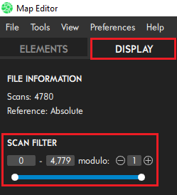

# Tips to save battery

Due to its various and powerful features, Map Editor can be quite resource-consuming but this section gives you some tips to optimize and extend battery power.

 

## TIP 1: Run Map Editor with a GPU { #gpu }

It is highly recommended to run Map Editor with a Graphics Processing Unit instead of a Central Processing Unit.

## TIP 2: Filter scans { #scans }

You can filter the number of scans displayed on screen.

To limit the number of scans displayed:

1.  In the left pane, click on the **DISPLAY** tab.
2.  In the **Scan filter** section, use the slider to define the number of scans displayed. You can also enter the numbers of scans manually.
3.  Increase the modulo according to your needs. If you increase the modulo to 3, 1 in 3 scans will be displayed.

*Filtering scans*

## TIP 3: Hide the sensor map { #sensor }

If you don't need the sensor map or reach a stage where you no longer need the sensor map for the map creation, you can hide the sensor map:

1.  In the left pane, click on the **ELEMENTS** tab.
2.  Click on the hide icon  next to **SENSOR MAP**.
