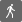

# Understanding Icons

The tools bar includes various tools to help you create and edit HDmaps. The following section identifies and describes the tools. For more information on how to use each tool, see the following sections: Creating HD Maps and Using Sensor Maps.

## Tools icons { #icons }

| Tool icons                                                  | Name                  | Description                                                                                                                                                                                                                                     |
|-------------------------------------------------------------|-----------------------|-------------------------------------------------------------------------------------------------------------------------------------------------------------------------------------------------------------------------------------------------|
|               | Scan selection        | Scan selection allows you to select a scan and view information related to the selected scan.                                                                                                                                                   |
|             | Point selection       | Point selection allows you to select a point and view information related to the selected point.                                                                                                                                                |
|           | Cuboid selection      | Cuboid selection allows you to manually define clusters.                                                                                                                                                                                        |
|         | Cluster selection     | Cluster selection allows you to select and identify clusters.                                                                                                                                                                                   |
|            | HDmap selection       | HDmap selection allows you to select and edit elements in the HD map.                                                                                                                                                                           |
|                                | Node                  | A node represents an end of an edge. The nodes define the width of the lane. The nodes can be created from road information.                                                                                                                    |
|  | Node from scan center | The node is created from the scan center. The scan centers are the log points.                                                                                                                                                                  |
|                                  | Edge                  | An edge represents a lane. It includes a direction or both and can be drivable or not.                                                                                                                                                          |
|                          | Terminal              | A terminal represents a station. Its position is displayed in x, y and z.                                                                                                                                                                       |
|                                  | Stop sign             | Stop sign creates a stop sign and the respective road marking. The stop sign can also be virtual. If you have several itineraries after the stop sign, you can define the priorities.                                                           |
|                                | Yield sign            | Yield sign creates a yield sign and the respective road marking. The yield sign can also be virtual. If you have several itineraries after the yield sign, you can define the priorities.                                                       |
|                  | Traffic light         | Traffic light creates a traffic light and the respective road marking. The traffic light can also be virtual. If you have several itineraries after the traffic light, you can define the priorities. If required, you can add V2X information. |
|                      | Pedestrian area       | Pedestrian area creates a pedestrian area from three points. If needed, you can add a stop lane before the pedestrian area.                                                                                                                     |
|                                  | Turn signal           | You can define the light side of the turn signal in a selected itinerary. If there's more than one itinerary, you can define the light side depending on the itinerary.                                                                         |
|                 | Desired speed         | You can define the desired speed in a selected itinerary. If there's more than one itinerary, you can define the desired speed depending on the itinerary.                                                                                      |
|                              | Region of interest    | You can define a specific area or element as region of interest. The regions of interest are colored. Regions of interest from the same family are colored in the same color.                                                                   |
|                            | Measure Tool          | Measure tool allows you to measure any distances (x,y,z) and slopes between two defined points.                                                                                                                                                 |
|                              | Volume test           | Volume test allows you to create an element of a defined volume. You can test if a lane is appropriate for a vehicule of a defined volume.                                                                                                      |
|                              | Turning Radius tool   | Turning radius tool identifies all the turnings of a defined radius.                                                                                                                                                                            |
