# Navigating the Map Editor

You can create and edit maps using various elements in the Map Editor workspace such as panels, bars and windows. To leverage the full potential of the Map Editor, get familiar with the Map Editor workspace.

## Overview { #overview }

When you launch **Map Editor**, the home screen appears. It includes the following elements:

1.  **Top bar**: it includes various settings related to the software.
2.  **Left panel**: it includes two tabs: **Elements** and **Display**. **Elements** refers to the elements currently on the map you are working on. **Display** allows you to manage the display settings.
3.  **Map window**: it displays the map you are working on.
4.  **Tools panel**: it contains tools for creating, editing, and adding elements to the map.

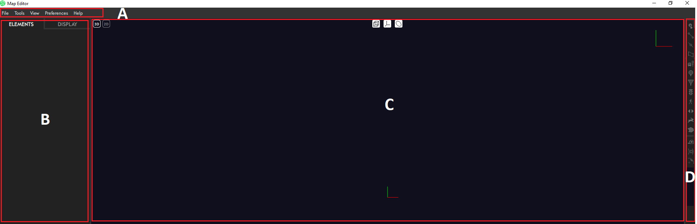

*A: Top bar \| B: Left panel \| C: Map window \| D: Tools panel*

## Top bar { #topbar }

The top bar includes various settings to manage the software configuration and preferences.

**File**

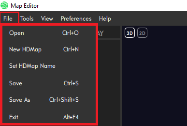

*File tab*

-   **Open**: select and open a map from your computer. To open a map in the **Map Editor**, you can also drag and drop a map in the map window.

-   **New HDMap**: create a HDmap. When you click on **New HDMap**, a **HDMAP Name** window appears. Rename the map then click **OK**.

-   **Set HDMap Name**: rename a HD map.

-   **Save**: save a map.

    !!! note

        The filename extension of HDmap file is .db.

-   **Save as**: save a map in the location you have selected.

    !!! note

        The map is automatically saved every five minutes in the location where you saved the original file. To close a file, you have to quit the software.

    If the map you have created is invalid, an error message appears in the **Save** window. To understand and fix the errors, click on the **Show errors** button. An **Errors** window appears with the list of errors.

    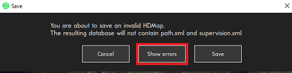

    *Save window with an error message*

-   **Exit**: close **Map Editor**. When you click on **Exit**, an **Exit** window appears. You can do one of the following:
    -   **Cancel**
    -   **Exit**
    -   **Save and Exit**

**Tools**

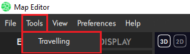

*Tools tab*

-   **Travelling**: You can travel in the map from a defined point to another.

To travel in the map:

1.  In the top bar, click **Tools** &gt; **Travelling**.

    **Result:** The **Travelling** section appears at the bottom of the left panel.

2.  Enter the following parameters:
    -   **Start scan**: the scan number at which the travelling begins.
    -   **End scan**: the scan number at which the travelling ends.
    -   **Camera Height**: the height of the camera in meters.
    -   **Δt interscan**: the delta time between two scans.

3.  If required, check one or both options:
    -   **180° switch**
    -   **reverse**

4.  Click on the button play .

**View**

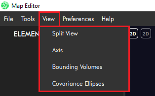

*View tab*

-   **Split View**: split the map into two maps in the map window.
-   **Axis**: show scan axis.
-   **Bounding Volumes**: show scan centers.
-   **Covariance Ellipses**: show covariance ellipses.

!!! note

    When you select **Bounding volumes**, **Axis**, or **Covariance Ellipses**, their respective icons 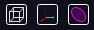 are activated in the map window.

**Preferences**

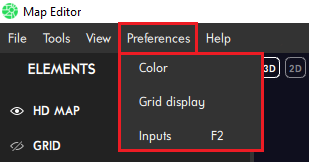

*Preferences tab*

-   **Color**: define the color of the elements in the map.

    To set color preferences:

    1.  In the top bar, click **Preferences** &gt; **Color**.

        **Result:** A **Colors Preferences** window appears.

    2.  Define the color of the elements in the following categories:
        -   INTERACTION COLORS
        -   ELEMENTS COLORS

    3.  Depending on the categorie, click one of the following buttons to reset the colors preferences:
        -   **Reset Default Values**
        -   **Reset Point Label Default Values**

-   **Grid display**: define the parameters of the displayed grid on the map in the map window. The grid is a representation of the ground based on the ground points. When you create a point in HD maps, the point will be created on the ground. If there is no ground in the lidar map, the HD map will be based on the lidar points. The grid is an information tool and not a measuring tool. Specific tools are available for measuring purposes.

    !!! note

        The grid is only available if the map has ground attributes.

    To define the parameters of the Grid display:

    1.  In the top bar, click **Preferences** &gt; **Grid display**.

        **Result:** A **Grid Display** window appears.

    2.  Enter the following parameters:

        -   step
        -   angle
        -   color
        -   opacity

        !!! note

            The parameters of the grid display allows you to modify the representation of the grid in the **Map Editor**. It does not modify the map.

-   **Inputs**: display a list of keyboard shortcuts according to your keyboard configuration.

**Help**

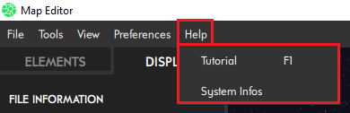

*Help tab*

-   Tutorial: redirection to the Map Editor documentation
-   System Infos: display the following system information:
    -   System
    -   OpenGL Version
    -   OpenGL Vendor

## Left panel { #leftpanel }

The left panel includes two tabs: **Elements** and **Display**.

### 

Elements

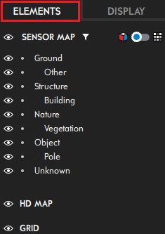

*Elements tab*

The **Elements** tab lists the elements displayed on the map in the map window. To customize the elements displayed according to your needs, you can use the following features:

-   [Filter](#filter)
-   [Hide](#hide)
-   [Highlight](#highlight)
-   [Colorization](#colorization)

**Filter**: For sensor maps, you can filter the elements displayed on the map.

To filter elements on the map:

1.  Click on the filter icon .
2.  In the drop-down list, select one of the following elements you want to display on the map:
    -   **All**: all the points are displayed.

    -   **Only Clusters**: only the clusters are displayed. Clusters are groups of points identified by algorithms.

    -   **Only Single Points**: all the points are displayed, except for clusters.

        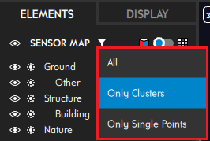

        *Sensor map filter*

**Hide**: To hide an element, click on the eye icon .  
**Highlight**: To highlight an element, click on the point next to the element.

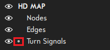

*Higlight elements*

A highlight icon 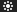 appears next to the highlighted elements.

**Colorization**: To color elements, make sure you have highlighted the elements you want to color. By default, elements are colored in colors defined in **Preferences** &gt; **Color**. For more information on how to set color preferences, see the following section: [Preferences &gt; Color](#color).

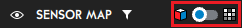

*Color switch*

The color switch can be set to one of the following modes:

-   **Rubik's cube** *(left)* 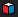 : By default, the color switch is set to the Rubik's cube. In this mode, all the elements in the same category are colored in the same color. For example, all the trees are colored in green since all the elements in the Nature category are colored in green by default.

    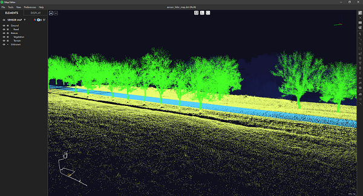

    *All the trees are colored in green*

      

-   **Flat Rubik's cube** *(right)* 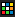 : In this mode, random colors are assigned to each element. This mode allows you to differentiate each element. For example, all the trees previously in green will individually be assigned a different color and you will be able to distinguish one tree from another.

    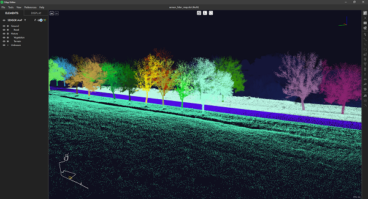

    *All the trees are colored in random colors.*

### 

Display

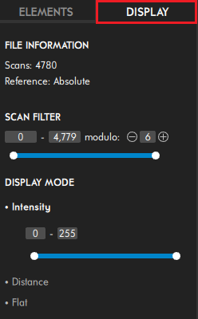

*Display tab*

The **Display** tab includes the three following sections:

-   **File information**: you can view the number of scans and the reference of the map.
-   **Scan filter**: it allows you to select the scans you want to display.
    -   Scan filter slider: You can filter scans from the first to the last recorded scans. The lowest value is the first scan recorded and the highest value is the last scan recorded.
    -   Modulo: it allows you to reduce the density of displayed scans. For example, modulo 2 displays one scan out of 2 and modulo 3 displays one scan out of 3. It can be very useful to optimize and extend battery power. For more information on how to save battery while using the Map Editor, see [Tips to save battery](battery.md).
-   **Display mode**: there are three different display modes
    -   Intensity: you can use the slider to adjust the intensity of points. The range of intensity points is between 0 and 255. During the mapping, a point is assigned an intensity value according to its reflectivity. The points below the lowest defined value (left handle) are displayed in black and the points above the highest defined value (right handle) are displayed in white. Adjusting the intensity allows you to have a better view of the signs, road markings, buildings, etc. It is recommended to work on maps in intensity display mode.

        !!! note

            The intensity display mode is not always available. There's no intensity display mode for 2D maps.

    -   Distance: this display mode is based on the proximity of points. The closer you are from a road sign, the easiest you can see it.

    -   Flat: No reliefs is displayed in this mode. This mode is appropriate for 2D maps.

## Map window { #mapwindow }

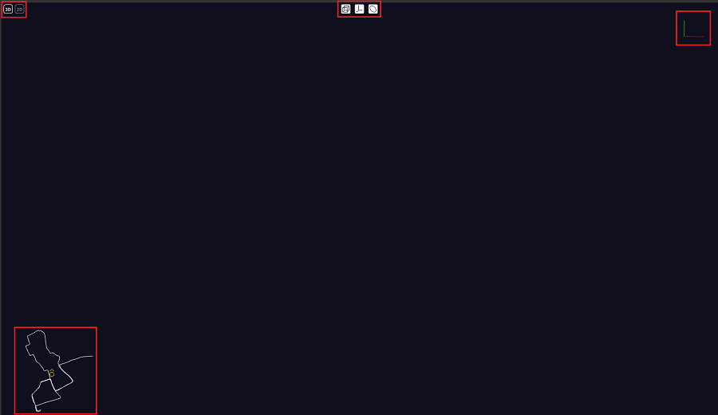

*Map window*

 

<table>
<colgroup>
<col style="width: 50%" />
<col style="width: 50%" />
</colgroup>
<thead>
<tr class="header">
<th>Elements in the Map Window</th>
<th>Description</th>
</tr>
</thead>
<tbody>
<tr class="odd">
<td>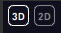</td>
<td>You can select one of the following camera views:
<ul>
<li>3D: Freefly camera</li>
<li>2D: Topview camera</li>
</ul>

@@ADM:note@@ For map creation, it is highly recommended to work with the Top view camera (2D). You can switch to the Freefly camera to edit details.
</td>
</tr>
<tr class="even">
<td>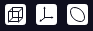</td>
<td>Click on the icons to add the following view options:
<ul>
<li>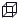: displays scan centers</li>
<li>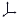: displays scan axis</li>
<li>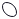: displays covariance ellipses</li>
</ul></td>
</tr>
<tr class="odd">
<td>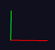</td>
<td>It indicates the map axis.</td>
</tr>
<tr class="even">
<td>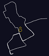</td>
<td>You can view your position on the miniature map. You can change your position by clicking on the selected position in the miniature map.</td>
</tr>
</tbody>
</table>

  

## Tools panel { #toolspanel }

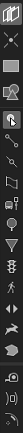

The tools in the tools panel allow you to create and edit maps. For more information on each tool, see the following section:  
[Understanding Icons](icons.md).
