# HD Maps Behaviors

HD Maps allows you to define specific behaviors for each itinerary. Behaviors are assigned to road elements such as traffic signs, speed limits, and priorities.

## About HD Maps behaviors { #behaviors }

### What are HD Maps behaviors?

HD Maps behaviors are intepretations of road elements in the HD map. There are two types of behavior:

-   Zone: the defined behavior is applied within a specific zone. The behaviors of speed limits and turn signals are limited within a zone.
-   Punctual: the defined behavior is applied at a specific point. Traffic signs, pedestrian areas, and priorities have behaviors defined at a specific point.

### Defining the behavior zone

When you define an itinerary, a behavior is only considered if it's included in the mission (see Figure a). If the behavior is defined before or after the mission, it won't be considered (see Figures b and c).

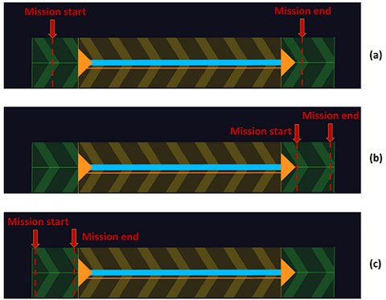

*Including a behavior in a mission*

If a part of a behavior starts before (see Figure d) or ends after the mission (see Figure e), this part is cropped and not considered.

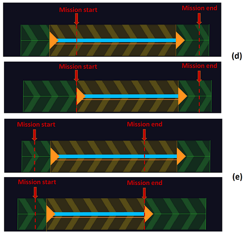

*Cropping behaviors outside of the mission*

## Defining concerned itineraries { #concerned }

The concerned itinerary of a behavior can include one lane, several consecutive lanes, or portions of lane. The concerned itinerary can be a factor on whether a behavior is considered in a mission.

### Defining a behavior on a concerned itinerary

A behavior can be considered depending on the mission and the concerned itinerary. The following table describes different situations including a mission (purple rectangle) and a concerned itinerary (blue line). Depending on the situation, the behavior (orange) can be considered or not.

| Situation                                                   | Description                                                                                                                                                                                                                                  |
|-------------------------------------------------------------|----------------------------------------------------------------------------------------------------------------------------------------------------------------------------------------------------------------------------------------------|
| 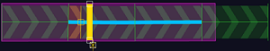                    | If a concerned itinerary is fully included in the mission, the behavior is considered.                                                                                                                                                       |
| 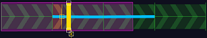 | If a concerned itinerary is included in the mission but the last lane of the concerned itinerary is only partially included, the behavior is considered. The last lane of the concerned itinerary needs to intersect with the mission lanes. |
| 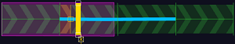                              | If the last lane of the concerned itinerary is not included at all in the mission, the behavior is not considered.                                                                                                                           |
| 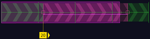                                | If there is no concerned itinerary, the behavior is considered within the mission. The part of the behavior before or after the mission is cropped.                                                                                          |
| 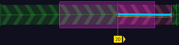                          | If a concerned itinerary has a length of one lane, the behavior is considered only if the concerned itinerary starts in the mission.                                                                                                         |

### Truncating a concerned itinerary

When the mission begins, the concerned itinerary is truncated to start at the same position as the mission (see Figures A). The behavior is also cropped by the algorithm later. The truncation was implemented to handle the situation in which the vehicle does not start at the station.

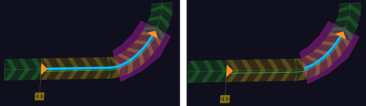

*Figure A: Before and after the truncation*

## Specific behaviors { #specific }

To define the behaviors of the road elements, you need to understand the specificities and limits of the zone and punctual behaviors.

### Defining zone behaviors

When you define zone behaviors such as turn signal or speed limits, it is highly recommended to follow the following rules:

-   Avoid superposing behaviors of the same type.
-   In the case of behaviors from several lanes joining into one, end the behaviors before they join the common lane. For example, it is important to not make turn signals or speed limits overlap on a common lane after the turn (see Figure A). If a mission starts on the common lane after the turn, the end of the concerned behavior will be considered.

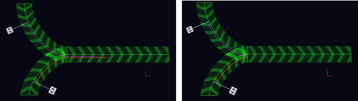

*Figure A: Left: unnecessary superposition of behaviors. Right: well designed concerned behaviors*

### Punctual behaviors { #punctual }
#### Priorities

You can define a priority area for the following behaviors:

-   Stop sign
-   Yield sign
-   Traffic light

When a behavior is associated with a priority area, the vehicle needs to give priority to this zone. The priority area can be a drivable lane where your vehicle or other vehicles can drive. For example, it can be a perpendicular lane when you stop at a stop on a crossroad. It can also be a non-drivable lane such as a crosswalk, bike lane, etc. or a non-drivable zone such as a crosswalk, bike lane, or a road outside of possible itineraries, etc.  

#### Defining priority areas

To define a sign behavior, you can add a stop lane (see the blue circle in Figure B). After you have defined a behavior, you can view the concerned itineraries associated with the behavior (see the purpose circle in Figure B). A behavior can have one or several priority areas associated with a concerned itinerary (see the circle orange in Figure B).

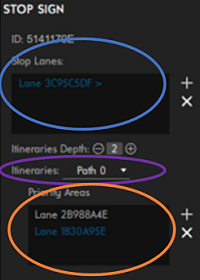

*Figure B: Stop sign behaviors*

  

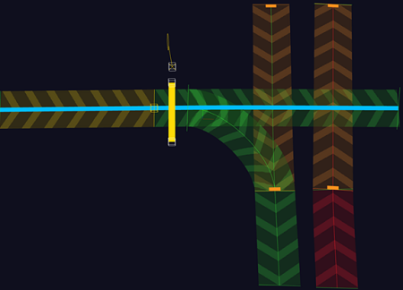

*Figure C: Two priority lanes are associated with a stop sign's straight concerned itinerary. One of the priority lanes is a non-drivable zone.*

  

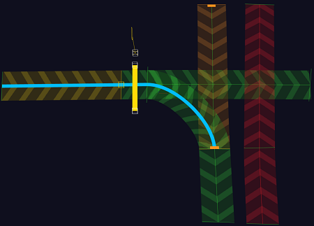

*Figure D: One of the priority lanes is associated with a stop sign's turning concerned itinerary*
