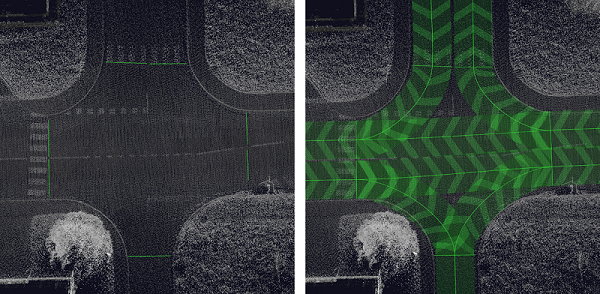
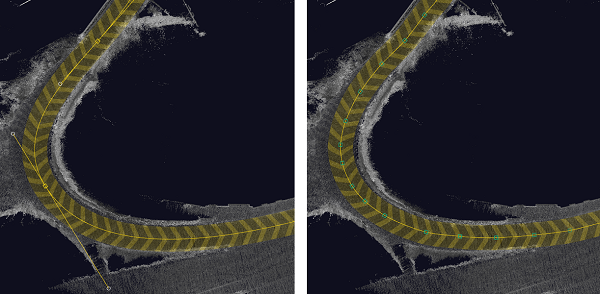
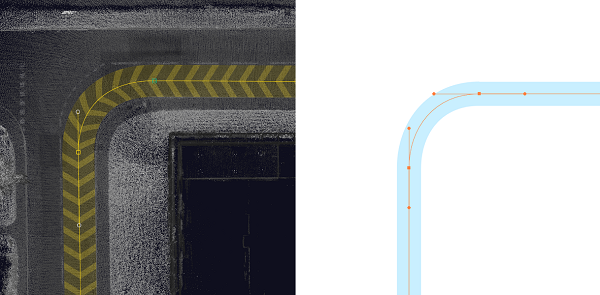
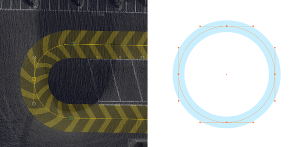
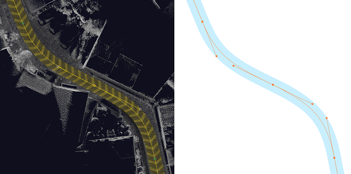

# Creating Edges

The Edge tool allows you to create a lane between two nodes. Before you create an edge, make sure you have created at least two nodes.

## Creating edges { #createedge }

To create an edge:

1.  In the tool bar, click on the **Edge** icon .

2.  Click to select a node then the other.

    !!! note

        The order in which you select nodes defines the driving direction. If required, you can still modify the driving direction in the edge properties. For more information on how to edit edge properties, see [Defining edge properties](#edgesprop)

You have created an edge. If the edge has a specific shape, you can use control points to draw this specific shape. For more information, see [Drawing edge shapes](#drawing)

## Defining edge properties { #edgesprop }

To define edge properties:

1.  In the tool bar, click on the **HDMap Selection** icon .

    **Result:** An **Edge** section at the bottom of the left pane appears. You can view the following information: ID, lane ID and lane length.

2.  Define the following properties:
    -   **Lane Width** (in meters)

    -   **Default desired speed** (in km/h)

        !!! note

            It is highly recommended to use the **Default desired speed** property to define the vehicle speed on a path. The [**Desired speed**](speed.md) behavior allows you to modify the default desired speed on a specific part of the path.

    -   **Driving Direction**: You can select one driving direction or its opposite. If you select both directions, the lane has no driving direction.

    -   **Drivable**: Check if you want the lane to be drivable. If the lane is not drivable, it is colored in red.

    -   **Control points**: Use control points  to modify the shape of an edge. For more information on drawing edge shapes, see the following section: [Drawing edge shapes](#drawing)

## Drawing edge shapes { #drawing }

### Recommendations

Before you start drawing edges, keep the following recommendations in mind:

-   Start by creating the nodes then draw the edges (see Figures A and B).

    

    *Figure A: Creating nodes \| Figure B: Drawing edges*

-   Reduce the number of control points as much as possible (see Figures C and D).

    

    *Figure C: Appropriate number of control points \| Figure D: Too much control points*

### How to draw edge shapes

-   A simple turn: place a control point before and after the turn. Vectors need to be tangent to the lane curve.

    

-   A U turn

    

-   A chicane or a change of direction: place control points at the change in direction. It should be the moment when the vehicle wheels are straight.

    
