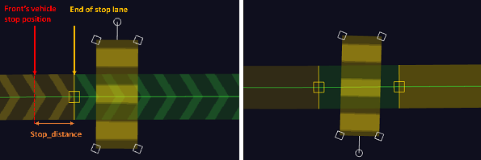

# Creating pedestrian areas

You can create and place a pedestrian area at its actual position in the map. Stop lanes can also be associated to a pedestrian area.

!!! tip

    Since pedestrian areas are part of the HD Maps behaviors, it is highly recommended to read the following part: [HD Maps Behaviors](behaviors.md) before you start creating pedestrian areas. After reading this part, you will be able to better understand how HD Maps behaviors work and how to define them according to your needs.

## About pedestrian areas { #abtpedestrian }

Priority areas are defined by the following features:

-   A rectangular zone that delimits the crosswalk. The first two points placed are the entrance / exit of the crosswalk for pedestrians. The third point you need to place is one of the points of the entrance / exit of the crosswalk.
-   The vehicle stops at the point(s) on the lane to let pedestrians cross. There are two points for bi-directional lanes and one point for unidirectional lane (see Figure A).

*Figure A: Left: Unidirectional lanes. Right: Bi-directional lanes*

!!! note

    Pedestrian areas don't have concerned itineraries since they are always considered.

## Creating a pedestrian area { #pedestrian }

To create a pedestrian area:

1.  In the tools bar, click on the **Pedestrian Area** icon 

    **Result:** A small square hovers with the pointer. The first two squares represent the ends of the pedestrian area entry.

2.  Click to place the two ends of the pedestrian area entry.

    **Result:** A third small square hovers the pointer. It allows you to define the length of the pedestrian area.

3.  Click to place the third square.

!!! note

    The order in which you place the small squares defines the orientation of the pedestrian area. However, you can still use the control point of the pedestrian area to change the orientation.

## Defining a stop lane { #stoplane }

The vehicle stops when the front end of the vehicle is at a specific distance from the end of the stop lane. This distance is defined in the configuration file decision.conf. The parameter **planner/stop\_distance** allows you to define the distance.

To define a stop lane associated to a pedestrian area:

1.  In the tool bar, click on the **HDMap Selection** icon .

2.  Select the pedestrian area to which you want to associate a stop lane.

3.  In the **Pedestrian Area** section of the left pane, click on the **+** icon.

    **Result:** A stop line hovers with the pointer on edges.

4.  Click to place the stop line on the edge.

    **Result:** The part of the edge before the stop line is now yellow. And the lane is identified in the **Stop Lanes** field in the **Pedestrian Area** section.

5.  *(optional)* To remove the stop lanes, click on the **X** icon.
