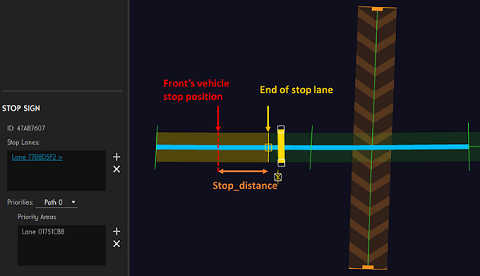
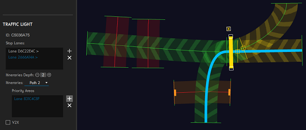
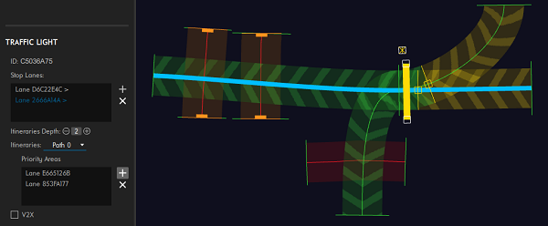

# Creating traffic signs

You can place the traffic signs at their actual position in the site. You can also define the behaviors and the priorities at a traffic sign.

!!! tip

    Since traffic signs are part of the HD Maps behaviors, it is highly recommended to read the following part: [HD Maps Behaviors](behaviors.md) before you start creating traffic signs. After reading this part, you will be able to better understand how HD Maps behaviors work and how to define them according to your needs.

## Stop sign { #stop }

### About Stop signs

The stop sign is defined by the following features:

-   the position of the sign
-   0 to N stops lanes which correspond to the N stop points where the vehicle should stop.
-   1 to M concerned itineraries with their associated priority areas

A stop sign can have several concerned itineraries. The concerned itinerary corresponds to the mission and defines the priority areas that need to be considered (see Figure A). You can also create a stop sign without an associated concerned itinerary. In this case, the stop sign is always considered.

*Figure A: A stop sign with a perpendicular priority lane*

!!! note

    The [**Yield sign**](#yield) edition is similar to the **Stop sign**. They have the same properties.

### Creating a stop sign

When you create a stop sign, you only create the physical sign and the associated road marking. If you want the vehicle to stop at the stop sign, you need to [define the behaviors and priorities](#stopbehavior).

To create a stop sign:

1.  In the tools bar, click on the **Stop sign** icon .

    **Result:** In 2D mode, a cross hovers with the pointer in the map window. The cross represents the stop sign.

2.  Click at the position where you want to place the stop sign.

    **Result:** In 2D mode, a square hovers with the pointer in the map window. The square represents one end of the stop road marking.

3.  Click to place each end of the stop road marking.

### Defining behaviors and priorities { #stopbehavior }

The vehicle stops when the front end of the vehicle is at a specific distance from the end of the stop lane. This distance is defined in the configuration file decision.conf. The **parameter planner/stop\_distance** allows you to define the distance..

To define behaviors and priorities:

1.  Select the stop sign you have created.

2.  In the **Stop Sign** section of left pane, click on the **+** icon next to the empty **Stop Lanes** field.

    **Result:** A white line hovers with the pointer on edges. The white line represents the stop line: the position where the vehicle stops.

3.  Click to place the stop line.

    **Result:** The lane on which you placed the stop line is identified in the **Stop Lanes** section of the left pane.

4.  Click on the icons **-** or **+** to define the **Itinerary Depth**. If you define the **Itinerary Depth** at 1, the current itinerary will take into account the following edge as part of its itinerary. If you define the **Itinerary Depth** at 2, the current itinerary will take into account the two following edges as part of its itinerary and so on.

5.  *(optional)* If there is more than one possible itinerary at the stop line, select a path in the **Itineraries** drop-down list.

    Depending on the selected itinerary, you can define a priority area. In other words, you can define that an edge is a priority over another edge.

6.  *(optional)* To define a priority area, click on the **+** icon next to the empty **Priority Areas** field then select the priority edge for this itinerary.

    **Result:** The selected priority edge is colored in orange. And the selected priority edges are identified in the **Priority Areas** section of the left pane.

### Deleting stop lanes and priority areas

To delete a stop lane:

1.  Select the stop sign you have created.
2.  In the **Stop Sign** section of left pane, select the stop lane you want to delete.
3.  Click on the **x** icon next to the **Stop Lanes** field.

You have deleted the stop lane. To delete a priority area, follow the same procedure in the **Priority Areas** field.

## Yield sign { #yield }

The yield sign edition is similar to the Stop sign. They have the same properties. For more information on yield signs, see [About stop signs](#stop).

### Creating a yield sign

To create a yield sign:

1.  In the tools bar, click on the **Yield sign** icon .

    **Result:** In 2D mode, a cross hovers with the pointer in the map window. The cross represents the yield sign.

2.  Click at the position where you want to place the yield sign.

    **Result:** In 2D mode, a square hovers with the pointer in the map window. The square represents one end of the yield road marking.

3.  Click to place each end of the yield road marking.

### Defining behaviors and priorities

The vehicle stops when the front end of the vehicle is on the yield sign position.

To define behaviors and priorities:

1.  Select the stop sign you have created.

2.  In the **Yield Sign** section of left pane, click on the **+** icon next to the empty **Stop Lanes** field.

    **Result:** A white line hovers with the pointer on edges. The white line represents the stop line: the position where the vehicle stops.

3.  Click to place the stop line.

    **Result:** The lane on which you placed the stop line is identified in the **Stop Lanes** section of the left pane.

4.  Click on the icons **-** or **+** to define the **Itinerary Depth**. If you define the **Itinerary Depth** at 1, the current itinerary will take into account the following edge as part of its itinerary. If you define the **Itinerary Depth** at 2, the current itinerary will take into account the two following edges as part of its itinerary and so on.

5.  *(optional)* If there is more than one possible itinerary at the stop line, select a path in the **Itineraries** drop-down list.

    Depending on the selected itinerary, you can define a priority area. In other words, you can define that an edge is a priority over another edge.

6.  *(optional)* To define a priority area, click on the **+** icon next to the empty **Priority Areas** field then select the priority edge for this itinerary.

    **Result:** The selected priority edge is colored in orange. And the selected priority edges are identified in the **Priority Areas** section of the left pane.

### Deleting stop lanes and priority areas

To delete a stop lane:

1.  Select the stop sign you have created.
2.  In the **Stop Sign** section of left pane, select the stop lane you want to delete.
3.  Click on the **x** icon next to the **Stop Lanes** field.

You have deleted the stop lane. To delete a priority area, follow the same procedure in the **Priority Areas** field.

## Traffic light { #light }

### About traffic lights

Traffic lights are defined by the following features:

-   the position of the traffic light in the map
-   0 to N stop lanes which correspond to the N stop points where the vehicle should stop for the traffic light. You can create several affected lanes for one traffic light.
-   1 to M concerned itineraries with their associated priority areas

A stop sign can have several concerned itineraries. The concerned itinerary corresponds to the mission and defines the priority areas that need to be considered (see Figures B and C).

!!! note

    As of Mar 10th, 2020, the assigned priorities are not yet considered for traffic lights.

*Concerned itinerary with one associated priority lane*

*Concerned itinerary with two associated priority lanes*

### Creating a traffic light

To create a traffic light:

1.  In the tools bar, click on the **Traffic Light** icon .

    **Result:** In 2D mode, a cross hovers with the pointer in the map window. The cross represents the traffic light.

2.  Click at the position where you want to place the traffic light.

    **Result:** In 2D mode, square hovers with the pointer in the map window. The square represents one end of the traffic light road marking.

3.  Click to place each end of the traffic light road marking.

### Defining behaviors and priorities

The vehicle stops when the front end of the vehicle is at a specific distance from the end of the stop lane. This distance is defined in the configuration file decision.conf. The parameter **planner/stop\_distance** allows you to define the distance.

To define behaviors and priorities:

1.  Select the stop sign you have created.

2.  In the **Traffic Light** section of left pane, click on the **+** icon next to the empty **Stop Lanes** field.

    **Result:** A white line hovers with the pointer on edges. The white line represents the stop line: the position where the vehicle stops.

3.  Click to place the stop line.

    **Result:** The lane on which you placed the stop line is identified in the **Stop Lanes** section of the left pane.

4.  Click on the icons **-** or **+** to define the **Itinerary Depth**. If you define the **Itinerary Depth** at 1, the current itinerary will take into account the following edge as part of its itinerary. If you define the **Itinerary Depth** at 2, the current itinerary will take into account the two following edges as part of its itinerary and so on.

5.  *(optional)* If there is more than one possible itinerary at the stop line, select a path in the **Itineraries** drop-down list.

    Depending on the selected itinerary, you can define a priority area. In other words, you can define that an edge is a priority over another edge.

6.  *(optional)* To define a priority area, click on the **+** icon next to the empty **Priority Areas** field then select the priority edge for this itinerary.

    **Result:** The selected priority edge is colored in orange. And the selected priority edges are identified in the **Priority Areas** section of the left pane.

### Deleting stop lanes and priority areas

To delete a stop lane:

1.  Select the stop sign you have created.
2.  In the **Stop Sign** section of left pane, select the stop lane you want to delete.
3.  Click on the **x** icon next to the **Stop Lanes** field.

You have deleted the stop lane. To delete a priority area, follow the same procedure in the **Priority Areas** field.

### Defining the V2X settings

To define the V2X settings:

1.  In the **Traffic Light** section of the left pane, check the **V2X** box.

    **Result:** The V2X settings appears.

2.  In the V2X drop down list, select the appropriate V2X standard.

3.  Enter the following parameters:
    -   Region ID
    -   Intersection ID
    -   Traffic light ID

## Creating a virtual sign { #virtual }

You can use virtual signs to place traffic signs that are not actually on the site. For example, it can be a priority on the right where there is no physical sign. You can create the following virtual traffic signs:

-   Stop sign
-   Yield sign
-   Traffic light

To create a virtual sign:

1.  In the tools bar, click on the icon of one of the following traffic signs: **Stop**, **Yield** and **Traffic light**.

2.  In the **Sign Creator** section at the bottom of the left pane, check the box **Virtual**.

    !!! note

        You can only place virtual signs on edges.

3.  Click at the position where you want to place the virtual sign. The vehicle stops at the position of the virtual sign.

4.  Define behaviors and priorities of the virtual sign. For more information on how to define behaviors and priorities, see the relevant section: Defining behaviors and priorities.
