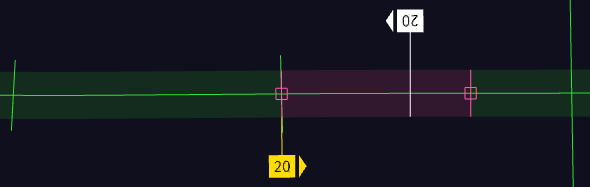
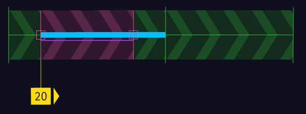

# Defining a desired speed

You can define a desired speed on a selected path or an itinerary.

!!! tip

    Since **Desired speed** is part of the HD Maps behaviors, it is highly recommended to read the following part: [HD Maps Behaviors](behaviors.md) before you start defining speed on a path or an itinerary. After reading this part, you will be able to better understand how HD Maps behaviors work and how to define them according to your needs.

## About desired speeds { #limit }

There are two types of velocity limits:

-   Default desired speed: The default desired speed for a lane. The default desired speed applies on both directions of the lane.

    !!! note

        It is highly recommended to use the **Default desired speed** property to define the vehicle speed on a path. The [**Desired speed**](speed.md) behavior allows you to modify the default desired speed on a specific part of the path. You can define the default desired speed in the properties of edges. For more information, see [Creating edges](edges.md).

-   Desired speed: a speed defined on a lane portion which takes over the default desired speed on this portion. A desired speed is defined by the following features:
    -   A direction
    -   A start and an end position on one or several consecutive lanes
    -   An optional concerned itinerary

If you don't define a concerned itinerary, the speed limit is automatically applied to the lanes on which a direction is defined.

## Define the vehicle speed on a path or an itinerary { #speed }

The velocity limit is considered when the front end of the vehicle is between the start and the end of the defined zone.

To define the vehicle speed on a path or an itinerary:

1.  In the tool bar, click on the **Desired speed** icon .

2.  In the **Desired Speed Creator** section of the left pane, enter the desired vehicle speed in the **Speed Value** field.

    **Result:** A line hovers with the pointer on edges.

    

    *Desired speed with a right direction*

3.  Click to place the start of the desired speed.

    **Result:** A pink line appears at the position where you placed the start of the desired speed. A second pink line hovers with the pointer on edges. It represents the moment when the desired speed is no longer applied. You can also add an itinerary and select the path in which you want to place the itinerary end.

4.  *(optional)* To add an itinerary, check the **Add itinerary** box in the **Desired Speed Creator** section of the left pane.

5.  *(optional)* To select a path at an intersection, select a path in the **Itineraries** drop-down list in the **Desired Speed Creator** section of the left pane.

6.  Click to place the end of the desired speed.

    **Result:** The defined vehicle speed is applied between the vehicle speed tag. The vehicle speed tag is represented by a square and and an arrow. The speed is indicated in the square.

    

    *Desired speed with a concerned itinerary defined*

## Editing the itinerary start { #start }

Before you edit an itinerary start, make sure you have added an itinerary when you have defined the vehicle speed. For more information on adding an itinerary, see [Define the vehicle speed on a path or an itinerary](#speed) .

To edit the itinerary start:

1.  In the tool bar, click on the **HDMap Selection** icon .

2.  Select the desired speed.

3.  In the **Desired Speed** section of the left pane, click on **+ Advanced tools**

    **Result:** The path where you have defined the vehicle speed is colored in purple and the itinerary line is blue.

4.  Click on the **Edit itinerary start** button.

    **Result:** A line hovers with the pointer on the path.

5.  Click to place the itinerary start.

## Editing the itinerary { #edit }

To edit the itinerary:

1.  In the tool bar, click on the **HDMap Selection** icon .

2.  Select the desired speed.

3.  Click on the **Edit itinerary** button.

4.  Click on the icons **-** or **+** to define the **Itinerary Depth**. By default, the itinerary depth is defined at 0. If you define the Itinerary Depth at 1, the current itinerary will take into account the following edge as part of its itinerary. If you define the Itinerary Depth at 2, the current itinerary will take into account the two following edges as part of its itinerary and so on.

5.  *(optional)* In the **Itinerary** field, select a path in the drop-down list if available.

    **Result:** The itinerary follows the path you have selected. The itinerary is represented by a blue line.

6.  Click on the **Apply** button.
