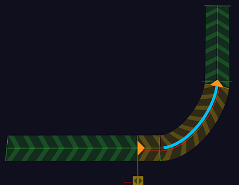
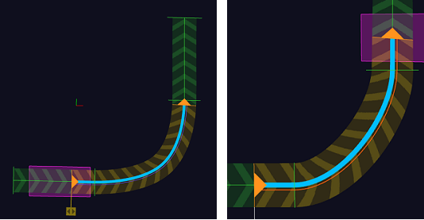

# Defining turn signals

You can define at which point in the itinerary the vehicle activates and deactivates the selected turn signal.

!!! tip

    Since turn signals are part of the HD Maps behaviors, it is highly recommended to read the following part: [HD Maps Behaviors](behaviors.md) before you start defining turn signals. After reading this part, you will be able to better understand how HD Maps behaviors work and how to define them according to your needs.

## About turn signals { #abtturn }

A turn signal is defined by the following features:

-   a direction
-   a start and an end position. It should start long enough before the turn and end at the end of the turn.
-   a concerned itinerary which starts in the zone of the turn signal and ends on or after the end of the turn signal.

### Concerned itinerary

The concerned itinerary should start just before the turn (see Figure A). If the mission stops before the turn, the itinerary won't include the turn signal and the vehicle won't blink unnecessarily.

*Figure A: The concerned itinerary starts when the turn starts.*

The concerned itinerary should end when the turn is over. It should not overlap with the lane following the turn. Otherwise, the vehicle blinks in the following straight lane (see Figure B).

*Figure B: Left: The behavior starts too early and is included in the mission when it should not be. Right: The behavior ends too late and the vehicle blinks pointlessly.*

## Defining a turn signal in a selected itinerary { #defturn }

The selected turn signal is activated when the front end of the vehicle is between the start and the end of the defined zone.

To define a turn signal in a selected itinerary:

1.  In the tools bar, click on the **Turn Signal** icon .

    **Result:** A line hovers with the pointer on edges. The line represents the itinerary start which is the moment when the turn signal is activated.

2.  Click to place the itinerary start.

    **Result:** An orange line and arrow appear at the position where you placed the itinerary start. A second orange line and arrow hover with the pointer on edges. It represents the end of the itinerary which is the moment when the turn signal is deactivated. At an intersection of two paths or more, select the path in which you want to place the itinerary end.

3.  *(optional)* To select a path at an intersection, select a path in the **Itineraries** drop-down list in the **Turn Signal Creator** section of the left pane.

4.  Click to place the itinerary end.

5.  In the **Turn Signal** section of the left pane, select the left or right arrow to activate the left or right turn signal.

**Result:** The selected turn signal is activated between the two orange arrows.

## Editing the itinerary start { #editturnstart }

To edit the itinerary start:

1.  In the tool bar, click on the **HDMap Selection** icon .

2.  Select the turn signal.

3.  In the **Turn Signal** section of the left pane, click on **+ Advanced tools**

4.  Click on the **Edit itinerary start** button.

    **Result:** A line hovers with the pointer on edges. The line represents the itinerary start which is the moment when the turn signal is activated.

    !!! note

        You can only place the itinerary start between the start and the end of the behavior.

5.  Click to place the itinerary start.

## Editing itineraries { #editturn }

To edit the itinerary:

1.  In the tool bar, click on the **HDMap Selection** icon .

2.  Select the turn signal.

3.  Click on the **Edit itinerary** button.

4.  Click on the icons **-** or **+** to define the **Itinerary Depth**. By default, the itinerary depth is defined at 0. If you define the Itinerary Depth at 1, the current itinerary will take into account the following edge as part of its itinerary. If you define the Itinerary Depth at 2, the current itinerary will take into account the two following edges as part of its itinerary and so on.

5.  *(optional)* In the **Itinerary** field, select a path in the drop-down list if available.

    **Result:** The itinerary follows the path you have selected. The itinerary is represented by a blue line.
