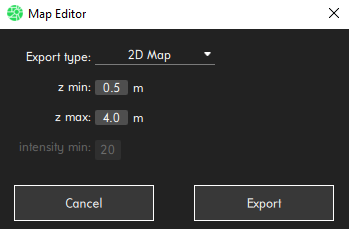

# Saving LiDAR maps

After you have edited LiDAR maps, you can save and export LiDAR maps according to your needs.

## Saving LiDAR maps { #save }

To save a LiDAR map:

1.  In the top bar, click **File** &gt; **Save As**.

    **Result:** A **Save as...** window appears.

2.  Select the location where you want to save the map.

3.  Click **Save**.

    **Result:** You have saved the LiDAR map and the filename extension of LiDAR maps is .dat.

## Exporting LiDAR maps { #export }

To export a LiDAR map:

1.  In the top bar, click **File** &gt; **Export**.

    **Result:** A **Map Editor** window appears (see Figure A).

    

    *Figure A: Map Editor export window*

2.  Depending of the type of export you want, select one of the following:
    -   **2D Map**: the points are flatten, and you can define the height range of the points you want to export: z min and z max (see Figure A).
    -   **Intensity**: you can define the height range (z min and z max) and the intensity threshold (intensity min) of the points you want to export.
    -   **LogPoints**: you can export all the logpoints of the map. Logpoints are the scan centers.

3.  Click on the **Export** button.

    **Result:** A **Save as...** window appears.

4.  Select the location where you want to export the map.

5.  Click **Save**.

    **Result:** You have exported the LiDAR map. If you have exported the map as 2D Map or Intensity map, the filename extension is .dat. If you have exported the map as LogPoints, the filename extension is .m.
