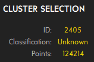
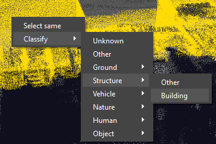
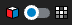

# Selecting clusters

You can select already identified clusters and classify them into categories. Clusters are groups of points identified by algorithms.

## Selecting clusters { #select }

To select clusters:

1.  In the tool bar, click on the **Cluster Selection** icon .

2.  To select a cluster, click on a cluster in the map.

    **Result:** The following cluster information appears in the **Cluster Selection** section at the bottom of the left pane (see Figure A):

    -   ID
    -   Classification
    -   Points

    

    *Figure A: Selected cluster information*

## Classifying clusters { #classify }

To classify a cluster:

1.  In the tool bar, click on the **Cluster Selection** icon .

2.  Click on a cluster in the map.

3.  Right click on the cluster.

    **Result:** A context menu appears (see Figure B).

4.  Select **Classify** &gt; *The classification of the selected cluster* .

    

    *Figure B: Classifying a cluster as building*

## Selecting clusters with the same classification { #selectsame }

To select clusters with the same classification:

1.  In the tool bar, click on the **Cluster Selection** icon .

2.  Click on a cluster in the map.

3.  Right click on the cluster.

    **Result:** A context menu appears.

4.  Select **Select Same**.

    **Result:** All the clusters with the same classification appear in color in the map. Depending on the mode set in the color switch , the clusters will either appear in the same color or in random colors. For more information on colorization, see [the following section on colorization](../getting-started/navigating.md#colorization).
