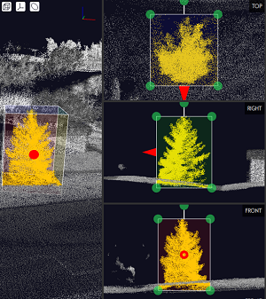
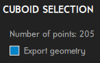

# Selecting cuboids

You can manually identify groups of points as clusters and classify the identified clusters.

## Defining a cluster { #define }

To define a cluster:

1.  In the tool bar, click on the **Cuboid Selection** icon .

2.  Hold the left mouse button on the cluster you want to define.

    **Result:** A cube with a blue top side, a right green side, and a red front side appears.

3.  Drag the mouse to roughly select the cluster.

    **Result:** The cluster is contained in the cube. A pane with the top, right, and front views of the cluster in 2D appears on the right (see Figure A).

    

    *Figure A: The identified cluster and the three views of the cluster on the right.*

4.  To better adjust the selection, use the corner handles of the three views in 2D.

5.  Right click on the selected cluster in the map.

    **Result:** A context menu appears.

6.  Select **Classify** &gt; *The classification of the selected cluster* .

## Exporting cluster coordinates { #export }

To export cluster coordinates:

1.  In the tool bar, click on the **Cuboid Selection** icon .

2.  In the **Cuboid selection** section in the left pane, check **Export geometry** (see Figure B).

    

    *Figure B: Export geometry in the left pane*

3.  Select and define the cluster from which you want to export the coordinates. For more information on how to select and define clusters, see [Defining a cluster](#define).

    **Result:** A file with the cluster coordinates is automatically created in the same location as the lidar map. The file extension is **.labelcubes**.
