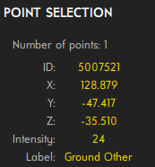
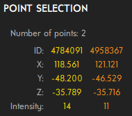
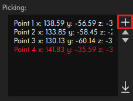

# Selecting points

You can view information about points and leverage this information according to your needs.

## Viewing point information { #view }

To view point information

1.  In the tool bar, click on the **Point Selection** icon .

2.  To select a point, click on a point in the map.

    **Result:** The following point information appears in the **Point Selection** section at the bottom of the left pane (see Figure A):

    -   ID
    -   Coordinates in X, Y, Z
    -   Intensity
    -   Label

    

    *Figure A: Selected point information*

## Comparing two points { #compare }

To compare two points:

1.  In the tool bar, click on the **Point Selection** icon .

2.  Press and hold the **Ctrl** key and click on the two points you want to compare.

    **Result:** The selected points are colored in different colors. By default, the first selected point is in yellow, and the second one in orange. You can view and compare the information of the two points in the **Point Selection** section at the bottom of the left pane (see Figure B). Point information takes the color of the point selected.

    

    *Figure B: Information from the two selected points in the respective color of their points*

## Exporting a list of point coordinates { #list }

To export a list of point coordinates:

1.  In the tool bar, click on the **Point Selection** icon .

2.  To select a point, click on a point in the map.

3.  In the **Picking** field in the **Point Selection** section at the bottom of the left pane, click on the **+** (see Figure C).

    **Result:** The point coordinates appear in the **Picking** field.

    

    *Figure C: Point coordinates in the **Picking** field.*

4.  To save the point coordinates as a file, click on the download icon .

    **Result:** A **Save As...** window appears.

5.  Select the location where you want to save the file and enter a name for the file then click **Save**.

    **Result:** You have created a .path file with all the selected point coordinates.
