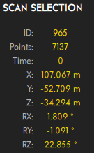
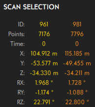
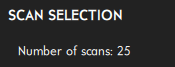

# Selecting scans

You can select one or multiple scans and view information related to the selected scans.

## Viewing scan information { #view }

To view scan information:

1.  In the map window, click on the **Show scans centers** icon .

    **Result:** The scan centers appear on the map.

2.  In the tool bar, click on the **Scan Selection** icon .

3.  To select a scan, click on a scan center.

    **Result:** Information related to the selected scan appears in the **Scan Selection** section at the bottom of the left pane (see Figure A).

    

    *Figure A: Selected scan information*

## Comparing two scans { #compare }

To compare two scans:

1.  In the map window, click on the **Show scans centers** icon .

    **Result:** The scan centers appear on the map.

2.  In the tool bar, click on the **Scan Selection** icon .

3.  Press and hold the **Ctrl** key and click on the scan centers of the two scans you want to compare.

    **Result:** The selected scan centers are colored in different colors. By default, the first selected scan center is in yellow, and the second one in orange. You can view and compare the information of the two scans in the **Scan Selection** section at the bottom of the left pane (see Figure B). Scan information takes the color of the scan center selected.

    

    *Figure B: Information from the two selected scans in the respective color of their scan centers*

## Selecting multiple scans { #select }

To select multiple scans:

1.  In the map window, click on the **Show scans centers** icon .

    **Result:** The scan centers appear on the map.

2.  In the tool bar, click on the **Scan Selection** icon .

3.  Do one of the following:

    -   Press and hold the **Shift** key and click on the first and the last scan center of the set of scans you want to select.
    -   Click and hold the left mouse button and move the cursor to select a set of scans.

    **Result:** The set of selected scan centers are colored in the same color. You can view the number of scans you have selected in the **Scan Selection** section at the bottom of the left pane (see Figure C).

    

    *Figure C: Number of selected scans*
